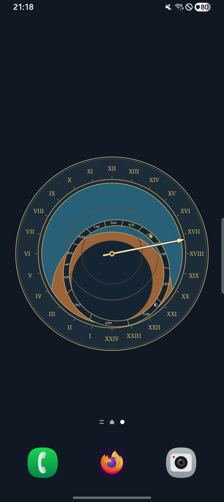
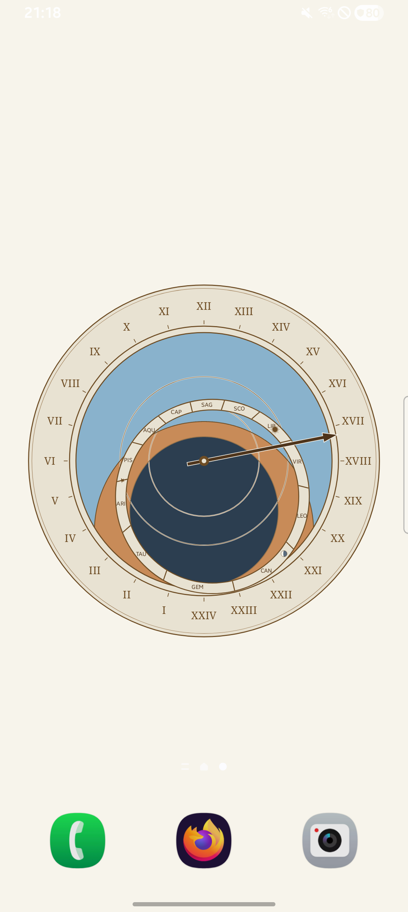
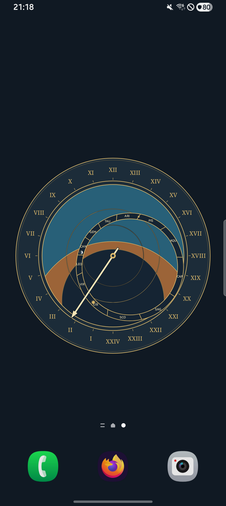
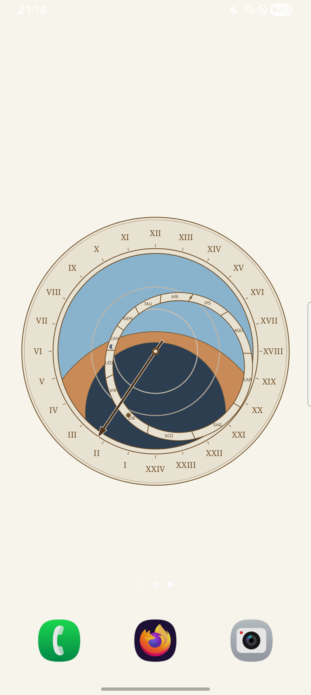
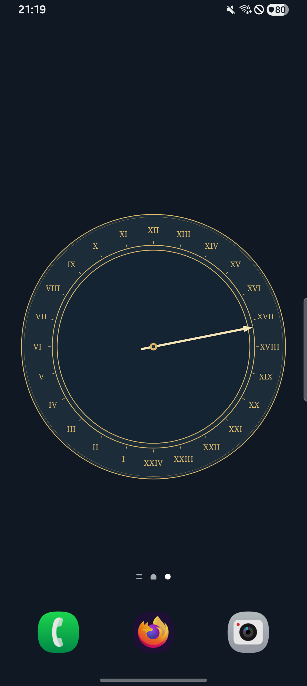
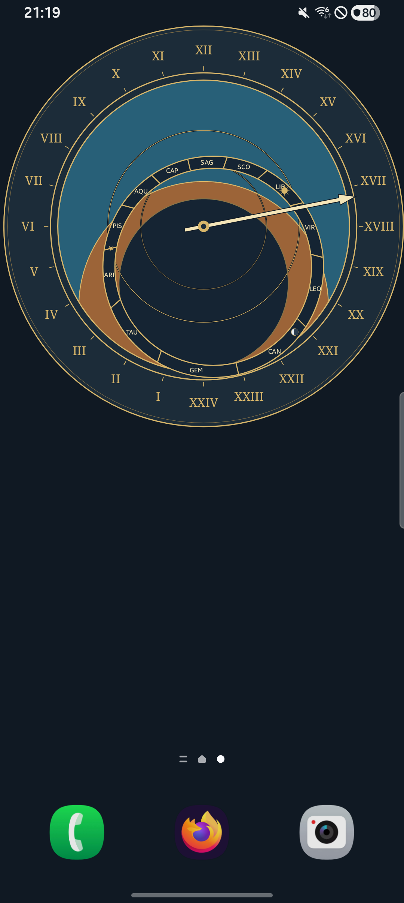

# Reviewed Wallpaper Visuals and Evidence Specification

This document maintains a curated set of representative wallpaper screenshots for the Astronomical Clock Wallpaper project, establishes evidence classification rules, and defines review and refresh ownership across contributors and maintainers.

The gallery images below are **physical-device captures** taken with `adb exec-out screencap -p` on the launcher's home screen. They are the reviewed visual baseline; host-side Canvas exports are a development aid and are not gallery evidence.

---

## 1. Representative Visual Gallery

The images below represent the rendered live wallpaper experience across core configurations. Every capture fixes the dial to the same virtual instant, `2026-10-04T15:15:36Z`, so the astronomy and civil hand are comparable across states.

### 1.1 Northern Hemisphere — Prague Orloj (50.08°N, 14.42°E)

Default historical instrument dial projection with all layers active (Sun, Moon, Zodiac ring, 24-hour civil hand).

| Dark Appearance | Light Appearance |
| :---: | :---: |
|  |  |
| **Physical device (Android 16 / API 36), 1080×2408 portrait, home screen (blank page), APK SHA-256 `4d59df10839053d2ccc927f4f15c261e4517f1aefafc542b479d57440be84ddc`, source `1ae1c97`, fixed instant `2026-10-04T15:15:36Z`** (`prague-dark-device-api36.png`) | **Physical device (Android 16 / API 36), 1080×2408 portrait, home screen (blank page), APK SHA-256 `4d59df10839053d2ccc927f4f15c261e4517f1aefafc542b479d57440be84ddc`, source `1ae1c97`, fixed instant `2026-10-04T15:15:36Z`** (`prague-light-device-api36.png`) |

*Dark appearance* uses a deep navy plate (`#101923`), a mid-blue daylight sky (`#286078`), and a near-black night/zodiac band (`#152433`), with high-contrast cream and gold inks. *Light appearance* uses an ivory plate (`#F7F4EB`), a pale blue daylight sky (`#89B2CC`), and deliberately keeps the night region dark (`#2C3E50`); because one dark surface remains, it uses contrast casings on elements crossing it to satisfy WCAG 2.1 contrast rules.

---

### 1.2 Southern Hemisphere — Sydney Orloj (33.87°S, 151.21°E)

Southern hemisphere plate. The projection keeps the same rotation sense in both hemispheres: as the sidereal angle increases, the sky rotates **clockwise** on screen. What changes is the zodiac ring, whose centre is point-reflected through the dial centre (a 180° phase shift across the equator), and the ecliptic polar distance, which becomes `1 + z` instead of `1 − z`. The altitude field depends only on `|latitude|`, so equal absolute latitudes in the two hemispheres shade the **same** altitude curves — they are not mirrored.

| Dark Appearance | Light Appearance |
| :---: | :---: |
|  |  |
| **Physical device (Android 16 / API 36), 1080×2408 portrait, home screen (blank page), APK SHA-256 `4d59df10839053d2ccc927f4f15c261e4517f1aefafc542b479d57440be84ddc`, source `1ae1c97`, fixed instant `2026-10-04T15:15:36Z`** (`sydney-dark-device-api36.png`) | **Physical device (Android 16 / API 36), 1080×2408 portrait, home screen (blank page), APK SHA-256 `4d59df10839053d2ccc927f4f15c261e4517f1aefafc542b479d57440be84ddc`, source `1ae1c97`, fixed instant `2026-10-04T15:15:36Z`** (`sydney-light-device-api36.png`) |

---

### 1.3 Unconfigured State and Display Composition

| Unconfigured Observing Site | Offset Display Composition |
| :---: | :---: |
|  |  |
| **Physical device (Android 16 / API 36), 1080×2408 portrait, home screen (blank page), APK SHA-256 `4d59df10839053d2ccc927f4f15c261e4517f1aefafc542b479d57440be84ddc`, source `1ae1c97`, fixed instant `2026-10-04T15:15:36Z`** (`no-location-dark-device-api36.png`) | **Physical device (Android 16 / API 36), 1080×2408 portrait, home screen (blank page), APK SHA-256 `4d59df10839053d2ccc927f4f15c261e4517f1aefafc542b479d57440be84ddc`, source `1ae1c97`, fixed instant `2026-10-04T15:15:36Z`** (`display-offset-dark-device-api36.png`) |

- **Unconfigured Observing Site**: When no geographic site has been selected, site-dependent astronomical elements (Sun, Moon, zodiac ring) are suppressed while the 24-hour civil clock continues to follow the device timezone.
- **Offset Display Composition**: Demonstrates display controls with 115% size scale and top-right positioning offsets (`size = 115`, `horizontal = 100`, `vertical = 0`).

---

## 2. Evidence Classification and Labeling

Every screenshot tracked in documentation must carry explicit attribution indicating its execution provenance.

### 2.1 Physical-Device Evidence

- **Source**: Screencap captured from physical Android hardware via ADB (`adb exec-out screencap -p`).
- **Required Metadata**:
  - Android platform version (e.g. Android 16) and API level (e.g. API 36).
  - Display resolution and orientation (e.g. 1080×2408 portrait).
  - Surface context (home screen, lit lock screen, or in-app preview).
  - Source commit SHA or tested APK SHA-256 checksum.
  - Known screenshot pipeline transforms (e.g. hardware color transformations, dithering).
- **Privacy Constraints**: In accordance with [CONTRIBUTING.md](../CONTRIBUTING.md#physical-device-testing-and-privacy), physical-device captures must strictly withhold hardware OEM/marketing model names, serial numbers, firmware build fingerprints, and precise private user coordinates.

The gallery in §1 uses the following capture conditions:

- **Hardware**: a physical Android 16 (API 36) device at its native 1080×2408 portrait resolution; the screen was not resized and the screenshot pipeline applied no known color transform (palette probes read back the configured RGB values exactly).
- **Surface**: the launcher home screen on a dedicated blank page. The standard launcher dock remains visible and is system UI, not personal content.
- **APK**: SHA-256 `4d59df10839053d2ccc927f4f15c261e4517f1aefafc542b479d57440be84ddc`, built from app source `1ae1c97`.
- **Virtual time**: the debug-only clock fixed to `2026-10-04T15:15:36Z` via the `DEBUG_SET_TIME` broadcast.
- **Limitation — status bar**: Android demo mode was requested (`sysui_demo_allowed` plus the `com.android.systemui.demo` broadcasts), but this OEM's SystemUI does not implement demo mode, so the standard status bar remains. It shows only system state (device time, battery, connectivity, and Do Not Disturb); notification icons were suppressed for the pass and no notification content is visible. The status-bar clock is the device's real time, not the fixed virtual instant, which drives only the wallpaper.

### 2.2 Host-Side Development Aid

- **Source**: Generated via `./gradlew exportRepresentativeImages` running Robolectric Native Graphics on a host JDK.
- **Output**: dial-only PNGs at 1080×1600 px under `app/build/reports/orloj`, with no launcher, status bar, or device color profile.
- **Status**: this harness is a **local development aid only**. Its output is neither physical-device nor emulator evidence and must not be checked into the gallery or used to close a verification requirement that names those environments.

---

## 3. Review and Refresh Ownership

1. **Contributor Responsibility**:
   Contributors who modify dial geometry, shaders, palette contrast, layouts, or visual components are responsible for regenerating and proposing updated representative images as part of their pull request.
2. **Reviewer Responsibility**:
   PR reviewers and maintainers must manually review visual changes:
   - Check that dial markings, numerals, and glyphs align correctly.
   - Confirm contrast ratios comply with [docs/orloj.md](orloj.md#palette-contrast).
   - Ensure image files are optimized PNGs without extraneous metadata or unintended layout regressions.
3. **Living Audit**:
   Reviewed screenshots serve as visual acceptance baselines for milestones (including Milestone v0.3 release Gate B).

---

## 4. Refresh Triggers

Visual captures must be kept current with production rendering, but should not experience unnecessary churn:

### Explicit Triggers (Refresh Required)
A visual refresh is required when a pull request introduces observable on-screen changes:
- Changes to astrolabe projection curves (horizon, twilight, unequal hour arcs).
- Alterations to zodiac ring geometry, compartment boundaries, glyphs, or equinox star position.
- Adjustments to Roman numerals, 24-hour hour marks, or the civil hand.
- Adjustments to palette definitions, stroke casings, or brightness overlays.
- Additions or modifications to display controls (size scaling, horizontal/vertical translation, margin insets).

### Non-Triggers (Refresh Forbidden)
Do not refresh or recommit screenshots for changes that have no visible rendering impact:
- Backend astronomical calculation or ephemeris algorithm optimizations with identical angular outputs.
- Battery, CPU, wake lock, or visible tick cadence optimizations.
- Android lifecycle, surface recreation, or settings persistence fixes.
- Host test refactoring, linter compliance, or CI script updates.

---

## 5. CI Automation Policy

**CI does not automatically replace or regenerate reviewed screenshots.**

- **Rationale**: Android Canvas rendering, typeface font-shaping, and antialiasing vary subtly across operating systems, JDK versions, GPU rendering pipelines, and physical displays. Automated replacement in CI introduces noisy false-positive Git diffs and invalidates human review.
- **Enforcement**: The host export task (`./gradlew exportRepresentativeImages`) is intentionally separated from automated CI build verification (`./gradlew qualityGate`). Gallery images are physical-device captures, checked into source control only after human inspection.

---

## 6. Regenerating the Gallery

Use this procedure when a refresh trigger in §4 applies. Record the APK SHA-256 and source revision in the PR; do not claim a capture you did not inspect.

1. **Build and install**
   ```sh
   env ANDROID_HOME="$ANDROID_HOME" ./gradlew qualityGate :app:assembleDebug
   env ANDROID_HOME="$ANDROID_HOME" ./scripts/verify-apk.sh
   shasum -a 256 app/build/outputs/apk/debug/app-debug.apk
   adb install -r app/build/outputs/apk/debug/app-debug.apk
   ```
2. **Back up before changing device state**: list the preference directory first, then copy only the files that exist, and record the launcher page and device settings that step 8 restores. The backups contain private coordinates, so keep them outside Git.
   ```sh
   mkdir -p wallpaper-pass-backup
   adb shell run-as io.github.godaniya.astronomicalclockswallpaper.debug \
     ls shared_prefs/ > wallpaper-pass-backup/prefs-list.txt
   grep -qx 'observing_location.xml' wallpaper-pass-backup/prefs-list.txt \
     && adb exec-out run-as io.github.godaniya.astronomicalclockswallpaper.debug \
       cat shared_prefs/observing_location.xml > wallpaper-pass-backup/observing_location.xml
   grep -qx 'appearance_settings.xml' wallpaper-pass-backup/prefs-list.txt \
     && adb exec-out run-as io.github.godaniya.astronomicalclockswallpaper.debug \
       cat shared_prefs/appearance_settings.xml > wallpaper-pass-backup/appearance_settings.xml
   grep -qx 'dial_display.xml' wallpaper-pass-backup/prefs-list.txt \
     && adb exec-out run-as io.github.godaniya.astronomicalclockswallpaper.debug \
       cat shared_prefs/dial_display.xml > wallpaper-pass-backup/dial_display.xml
   grep -qx 'dial_settings.xml' wallpaper-pass-backup/prefs-list.txt \
     && adb exec-out run-as io.github.godaniya.astronomicalclockswallpaper.debug \
       cat shared_prefs/dial_settings.xml > wallpaper-pass-backup/dial_settings.xml
   head -1 wallpaper-pass-backup/*.xml
   adb shell settings get global sysui_demo_allowed
   adb shell settings get global stay_on_while_plugged_in
   adb shell settings get system screen_off_timeout
   adb shell settings get system screen_off_pocket
   ```
   `adb exec-out` merges the remote stderr into stdout, so a missing file would otherwise be written into the backup as `cat: ... No such file or directory`. The `grep -qx` guard prevents that; a file absent from `prefs-list.txt` is recorded as absent and step 8 deletes it. Every copied file must begin with `<?xml` — if `head -1` shows anything else, or any other backup command fails, stop before seeding. Note the current launcher page and page count as well.
3. **Prepare a clean surface**: add or swipe to a blank home-screen page, clear and collapse the notification shade, and attempt demo mode. If the OEM ignores demo mode, verify that no notification content is visible and record the limitation as in §2.1.
4. **Seed each state** while the app process is alive, then let the framework restart it:
   ```sh
   adb shell run-as io.github.godaniya.astronomicalclockswallpaper.debug \
     tee shared_prefs/observing_location.xml < observing_location.xml
   adb shell run-as io.github.godaniya.astronomicalclockswallpaper.debug \
     tee shared_prefs/appearance_settings.xml < appearance_settings.xml
   adb shell run-as io.github.godaniya.astronomicalclockswallpaper.debug \
     tee shared_prefs/dial_display.xml < dial_display.xml
   adb shell run-as io.github.godaniya.astronomicalclockswallpaper.debug \
     rm shared_prefs/dial_settings.xml
   adb shell run-as io.github.godaniya.astronomicalclockswallpaper.debug kill "$(adb shell pidof io.github.godaniya.astronomicalclockswallpaper.debug)"
   ```
   `observing_location.xml` holds one string key `location`, for example
   `{"version":1,"latitude":50.08,"longitude":14.42,"source":"MANUAL","zoneId":"Europe/Prague"}`.
   `appearance_settings.xml` holds `appearance` = `DARK` or `LIGHT`.
   `dial_display.xml` holds integer `size`, `horizontal`, `vertical`, and `brightness`.
   Delete `observing_location.xml` for the unconfigured state. Deleting the already-backed-up `dial_settings.xml` makes the restarted process use the enabled defaults for the Sun, Moon, and zodiac layers; otherwise a saved choice to hide a layer would silently change the captured baseline. Step 8 restores the original file.
5. **Fix the virtual instant** and confirm the service log:
   ```sh
   adb shell am broadcast -a io.github.godaniya.astronomicalclockswallpaper.DEBUG_SET_TIME \
     --es instant 2026-10-04T15:15:36Z
   adb logcat -d -t 200 | grep 'Debug clock fixed to instant'
   ```
   The debug clock lives in the app process, so re-send the broadcast after every process restart.
6. **Capture** the blank page: `adb exec-out screencap -p > docs/visuals/<stem>.png`.
7. **Inspect every PNG** before accepting it: the site, appearance, and offset must match the filename, the dial must be fully visible, and no personal content may appear. A wrong state is a recapture, not a relabel.
8. **Restore** from the backup: write back the saved preference files, delete any file recorded as absent, restart the service, return to the original launcher page and page count, reset the debug clock (`--ez reset true`), and restore the demo-mode, stay-on, timeout, and pocket settings recorded in step 2. Verify each by readback.
